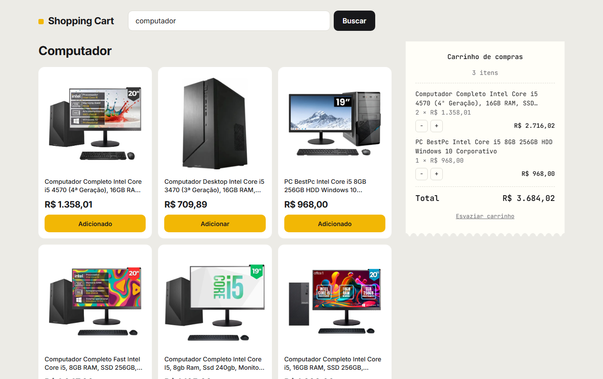
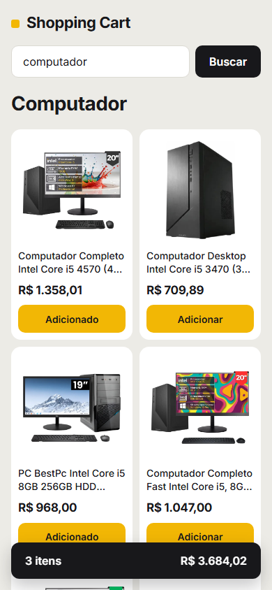

# Shopping Cart

A single-page store in plain JavaScript: search real Mercado Livre products and build a cart, printed like a store receipt, with a running total in Brazilian reais.

**Live demo:** https://gabrielncorreia.github.io/shopping-cart/





## Features

- Search products; the page opens with "computador"
- Add products to the cart, change quantities and empty it
- Cart saved in the browser, so it survives a reload
- On phones, the cart moves below the products and a bar at the bottom shows the item count and total

## How it gets the data

Mercado Livre's public listing search now refuses requests without a token, and a token cannot live in a static page. The page calls a small Cloudflare Worker, [mercado-livre-proxy](https://github.com/gabrielncorreia/mercado-livre-proxy), which holds the credentials and returns only the fields the page uses.

## Stack

Plain JavaScript, HTML and CSS, with no framework or build step. Product data is rendered with `textContent` only, so nothing from the API is ever parsed as HTML.

## About the project

Built individually at [Trybe](https://www.betrybe.com/).

In 2026 I moved it to the proxy and rewrote it: the cart used to be saved as raw HTML and read back with `innerHTML`, and the total was computed by parsing the cart's text. The cart is now a JSON list with quantities.

## Running locally

Start the proxy locally (see its README), which serves on `http://localhost:8799`. Then serve this folder with any static server, for example:

```sh
python -m http.server 5500
```

and open http://localhost:5500. The page uses the local proxy when it runs on `localhost`.
